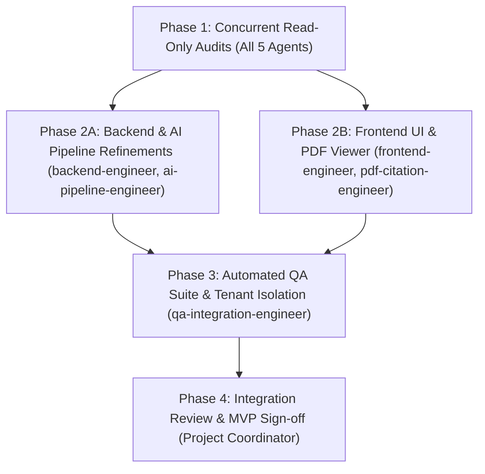

# Multi-Agent Coordination Guide & Architecture

This document governs the multi-agent development workflow for the **AI Research Intelligence Workspace**. It outlines agent boundaries, shared contracts, concurrency rules, worktree isolation procedures, and the MVP acceptance criteria.

---

## 1. Team Topology & File Ownership Matrix

To prevent merge conflicts, race conditions, and accidental overwrites, file ownership is strictly divided across five specialized agents overseen by the **Integration Lead / Project Coordinator**.

| Agent | Scope & Ownership | Prohibited File Paths |
| :--- | :--- | :--- |
| **`backend-engineer`** | `backend/app/main.py`<br>`backend/app/config.py`<br>`backend/app/database.py`<br>`backend/app/models.py`<br>`backend/app/schemas.py`<br>`backend/app/security.py`<br>`backend/app/runtime.py`<br>`backend/app/api/**`<br>`backend/app/documents/**`<br>`backend/app/workspaces/**`<br>`backend/Dockerfile`, `requirements.txt` | `frontend/**`<br>`workers/**`<br>`backend/app/parsing/**`<br>`backend/app/retrieval/**`<br>`backend/app/citations/**`<br>`tests/**` |
| **`ai-pipeline-engineer`** | `backend/app/parsing/**` (`pdf.py`, `chunking.py`)<br>`backend/app/retrieval/**` (`embeddings.py`, `qdrant_store.py`, `retriever.py`)<br>`backend/app/citations/**` (`llm.py`, `prompts.py`, `qa.py`, `validator.py`)<br>`workers/**` (`jobs.py`, `worker.py`, `Dockerfile`)<br>`backend/requirements-ml.txt` | `frontend/**`<br>`backend/app/api/**`<br>`backend/app/security.py`<br>`backend/app/database.py`<br>`backend/app/workspaces/**`<br>`tests/**` |
| **`frontend-engineer`** | `frontend/src/app/**`<br>`frontend/src/components/**` *(except `components/pdf/**`)*<br>`frontend/src/lib/**`<br>`frontend/package.json`<br>`frontend/tsconfig.json`<br>`frontend/Dockerfile` | `backend/**`<br>`workers/**`<br>`frontend/src/components/pdf/**`<br>`frontend/scripts/copy-pdf-worker.cjs`<br>`frontend/public/pdf.worker.min.mjs` |
| **`pdf-citation-engineer`** | `frontend/src/components/pdf/**`<br>`frontend/scripts/copy-pdf-worker.cjs`<br>`frontend/public/pdf.worker.min.mjs` | `backend/**`<br>`workers/**`<br>`frontend/src/app/**`<br>`frontend/src/lib/api.ts` |
| **`qa-integration-engineer`** | `tests/**`<br>`backend/tests/**`<br>`frontend/__tests__/**`<br>`evals/**`<br>`pytest.ini`<br>`scripts/verify*` | **Read-only on all application source code**:<br>`backend/app/**`<br>`frontend/src/**`<br>`workers/**` |
| **`project-coordinator`** | Architecture definitions, `.agents/**`, `AGENTS.md`, integration decisions, PR reviews, release acceptance | Application implementation code (delegated to specialized agents) |

---

## 2. Shared Interfaces & System Contracts

All agents must coordinate through locked, versioned interfaces. Changing a shared interface requires explicit Coordinator approval.

### A. Backend REST API Contract (`backend-engineer` ↔ `frontend-engineer`)
* **Auth**: `POST /api/auth/signup`, `POST /api/auth/login`, `GET /api/auth/me`
* **Workspaces**: `GET /api/workspaces`, `POST /api/workspaces`, `GET /api/workspaces/{id}`
* **Documents**:
  - `GET /api/workspaces/{id}/documents` → list documents with status (`queued`, `parsing`, `indexing`, `ready`, `failed`, `ocr_needed`)
  - `POST /api/workspaces/{id}/documents` (multipart/form-data) → upload PDF
  - `POST /api/workspaces/{id}/documents/{doc_id}/retry` → retry failed ingestion
  - `DELETE /api/workspaces/{id}/documents/{doc_id}` → purge document, chunks, and vector points
  - `GET /api/workspaces/{id}/documents/{doc_id}/file` → stream raw PDF binary
* **Ask**:
  - `POST /api/workspaces/{id}/ask` (`{ question: str, document_ids?: string[] }`)
  - **Constraint**: Returns `400 Bad Request` if no documents in the workspace are in `ready` status.
  - Returns: `{ id, question, abstained, abstain_reason, answer, claims: Claim[], citations: Citation[], latency_ms, ... }`

### B. AI Pipeline Contract (`ai-pipeline-engineer` ↔ `backend-engineer`)
* **Q&A Invocation**:
  ```python
  def answer_question(
      db: Session,
      *,
      workspace_id: str,
      user_id: str,
      question: str,
      document_ids: list[str] | None,
      retriever: Retriever,
      llm: LLMService,
      settings: Settings,
  ) -> Query:
      ...
  ```
* **Citation Grounding**:
  Every citation must map to a valid retrieved chunk. Unsupported claims must be flagged as `"unsupported"`; if evidence is absent or ungrounded, the system abstains with `"The sources do not answer this."`.

### C. Worker Contract (`ai-pipeline-engineer` ↔ `backend-engineer`)
* Ingestion job function: `workers.jobs.ingest_document(document_id: str)`
* Ingestion status flow: `queued` → `parsing` → `indexing` → `ready` (or `ocr_needed` / `failed`).

### D. PDF Citation Viewer Contract (`pdf-citation-engineer` ↔ `frontend-engineer`)
* Component: `<PdfCitationViewer ... />` in `frontend/src/components/pdf/PdfCitationViewer.tsx`
* Props:
  - `documentId: string | null`
  - `pdfBlob: Blob | null`
  - `targetPage: number | null` (1-indexed page to navigate to)
  - `highlightQuote: string | null` (text quote to locate and highlight)
  - `onPageChange?: (page: number) => void`
  - `onError?: (error: Error) => void`

---

## 3. Concurrency Model & Dependency Graph



### Execution Rules:
1. **Never edit files concurrently**: Two agents must never write to the same file at the same time.
2. **Start with read-only audits**: Each agent inspects existing architecture and test harnesses before authoring changes.
3. **Concurrent track separation**:
   - `backend-engineer` and `ai-pipeline-engineer` can work in parallel on backend and worker codebases because their directories do not overlap.
   - `frontend-engineer` and `pdf-citation-engineer` can work in parallel because `components/pdf/` is completely decoupled from the main page and layout.
   - `qa-integration-engineer` builds tests in `backend/tests/` and `tests/` without touching source code.

---

## 4. Worktree Isolation Protocol

When a task requires changes across boundary lines or when overlapping edits cannot be avoided, agents must use **isolated Git worktrees**:

```bash
# 1. Create an isolated worktree for an agent's feature track
git worktree add -b feat/agent-track ../worktrees/agent-track master

# 2. Agent works exclusively inside the worktree directory
cd ../worktrees/agent-track

# 3. Agent runs tests and validates clean build
pytest -v
npm run build

# 4. Agent pushes branch and opens PR/review for the Coordinator
git commit -am "feat: isolated implementation"
git push origin feat/agent-track

# 5. Coordinator reviews and merges, then cleans up worktree
cd ../master-repo
git worktree remove ../worktrees/agent-track
git branch -d feat/agent-track
```

---

## 5. MVP Acceptance Criteria

To be accepted for release by the Project Coordinator, the application must pass all 6 verification checks:

1. **PDF Upload**: User can upload valid text-based PDF files up to 20MB and 80 pages. Non-PDF files, files exceeding limits, or corrupted streams return clear error messages.
2. **Processing & Indexing**: Ingestion pipeline extracts text, creates chunks, embeds with `bge-small-en-v1.5`, and indexes points into Qdrant. Document status transitions cleanly from `Queued` → `Parsing` → `Indexing` → `Ready`. Scanned/empty documents flag `Needs OCR`.
3. **Ask Question**: User can submit natural-language research questions against the current workspace. The ask box remains disabled/locked with explanatory helper text until at least one document is `Ready`.
4. **Verifiable Citations**: Answers are structured into claims and numbered citations `[1]`, `[2]`. Every citation references a real document, page number, and quote excerpt. If evidence is lacking, the model cleanly abstains.
5. **PDF Page Jump**: Clicking citation `[N]` opens the PDF viewer pane, navigates immediately to the cited `page_number`, and displays/highlights the cited quote.
6. **Graceful Failure Handling**: Storage disconnects, worker exceptions, and network errors are trapped and surfaced as human-readable UI error states without unhandled exceptions or crashes.
