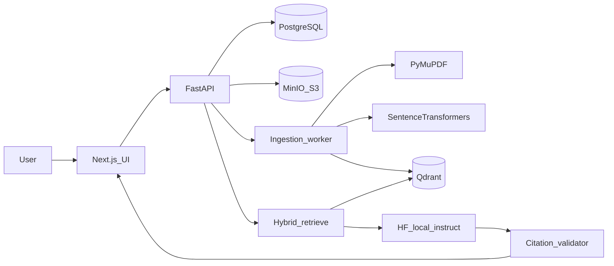

# AI Research Intelligence Workspace (MVP)

Empty git repo. Implement only the **upload → index → cited Q&A → page viewer** journey from [03_AI_Research_Intelligence_Workspace.pdf](C:\Users\tvabi\Downloads\03_AI_Research_Intelligence_Workspace.pdf). Comparison, evidence graph, evals, and Celery-at-scale wait until this slice is demoable.

## Product principle

The UI must make the next action obvious. Empty states, disabled controls, and status chips explain *why* something is unavailable (e.g. “Ask is locked until at least one PDF is Ready”). No chatbot-looking chrome; it should feel like a private research library.

## Architecture

**Stack (blueprint + Windows-friendly ops):**

- Frontend: Next.js (App Router) + TypeScript + Tailwind + shadcn, custom academic tokens
- Backend: Python FastAPI in `backend/`
- DB: PostgreSQL (`users`, `workspaces`, `documents`, `chunks`, `queries`, `claims`, `citations`)
- Vectors: Qdrant with `workspace_id` / `document_id` payload filters
- Files: MinIO (S3-compatible)
- Jobs: Redis + a **Linux Docker worker** (RQ or Celery). Celery on native Windows is avoided; everything runs in Compose
- Parsing: PyMuPDF; scanned/low-text pages marked `ocr_needed` (no OCR in MVP)
- AI (local, no paid API):
  - Embeddings: `BAAI/bge-small-en-v1.5` via Sentence Transformers
  - Synthesis: Hugging Face Transformers instruct model with a swapable `LLMService` (default `Qwen/Qwen2.5-1.5B-Instruct`; optional GGUF/CPU path documented). First run downloads weights into a volume
- Auth: email + password, JWT; every retrieval query filters by authorized workspace

## UI: classy, doubt-free

**Palette (library / archival):**

- Ink navy `#0F1C2E` (chrome, sidebar)
- Parchment `#F6F1E8` (canvas)
- Antique gold `#B8956C` (primary actions, citation marks)
- Sage `#4F6F5C` (Ready / supported)
- Terracotta `#A65D4F` (failed / unsupported / abstain)
- Hairline borders in warm gray, serif display (e.g. Source Serif) + sans body (e.g. Source Sans / Geist)

**Guided layout** (`/app/[workspaceId]`):

- Left: workspace switcher + document list with status (`Queued` / `Parsing` / `Indexing` / `Ready` / `Failed` / `Needs OCR`) and retry/delete
- Center: research thread (question, answer, numbered citations, “sources do not answer this”)
- Right: PDF.js viewer; clicking citation `N` opens that document at `page_number` and highlights the stored excerpt
- Top stepper when the library is empty: **1 Name workspace → 2 Drop PDFs → 3 Ask once a file is Ready**
- Ask box disabled until ≥1 Ready document; helper text names which files are still indexing
- Citation chips only for **server-validated** IDs; unsupported claims shown as flagged, never as fake links

## Backend workflows

**Ingestion:** validate PDF type/size/page cap → store original in MinIO → `documents.status` updates → extract page text + headings → skip/flag near-empty pages → chunk with page/heading metadata → embed → upsert Qdrant points → `Ready` or `Failed` with retry.
**Q&A:** retrieve only from current workspace (and optional selected docs) → pack token-budgeted context with citation IDs → prompt: answer *only* from evidence, cite claims, abstain if missing → parse structured claims/citations → **validate** document/page/chunk existence and that the chunk was in the retrieved set → persist `queries` / `claims` / `citations` with model/prompt/retrieval versions and latency.
**Prompt-injection:** document text is untrusted; system prompt instructs the model to ignore embedded instructions.
**Deletion (MVP policy):** delete object, PG rows, and Qdrant points for that document.

## Repo layout

Follow the blueprint:

- [frontend/](frontend/) — Next.js app
- [backend/app/api/](backend/app/api/), `documents/`, `parsing/`, `retrieval/`, `citations/`, `workspaces/`
- [workers/](workers/) — ingestion jobs
- [infra/](infra/) — `docker-compose.yml` (api, web, worker, postgres, qdrant, redis, minio)
- [docs/](docs/) — architecture, deletion policy, threat notes, limitations
- `.env.example` (no secrets)

## Implementation order

1. Compose + FastAPI health + Postgres schema + MinIO
2. Auth, workspace CRUD, tenant filter helpers
3. Upload + PyMuPDF parse + status polling API
4. Chunk/embed/Qdrant + worker
5. Cited Q&A + citation validator + local HF `LLMService`
6. Next.js guided UI + PDF viewer + citation jump
7. Isolation test (workspace A cannot retrieve B), README with reproducible `docker compose up`, sample-paper notes, known limits (small local model, no OCR, no comparison)

## Out of scope for this slice

Multi-document comparison export, knowledge graph, human evidence-review UI, OCR, DOCX/web import, Hugging Face paid Inference, OpenAI, production CI/evals beyond a tenant-isolation test and a tiny labeled Q→passage set stub in `evals/`.

to do

1. Scaffold frontend/, backend/, workers/, infra/docker-compose, .env.example, and core Postgres schema

2. Implement email/password JWT auth, workspaces, and backend tenant isolation on every query

3. PDF upload to MinIO, PyMuPDF page-aware parse, status/retry/delete, scanned-page flag

4. Chunking, local bge embeddings, Qdrant upsert/search with workspace filters

5. Local HF instruct LLM, structured claims, citation validation, abstention

6. Academic parchment/navy/gold UI: stepper, statuses, research thread, PDF.js citation jump

7. README, deletion/threat notes, docker smoke path, workspace isolation test
